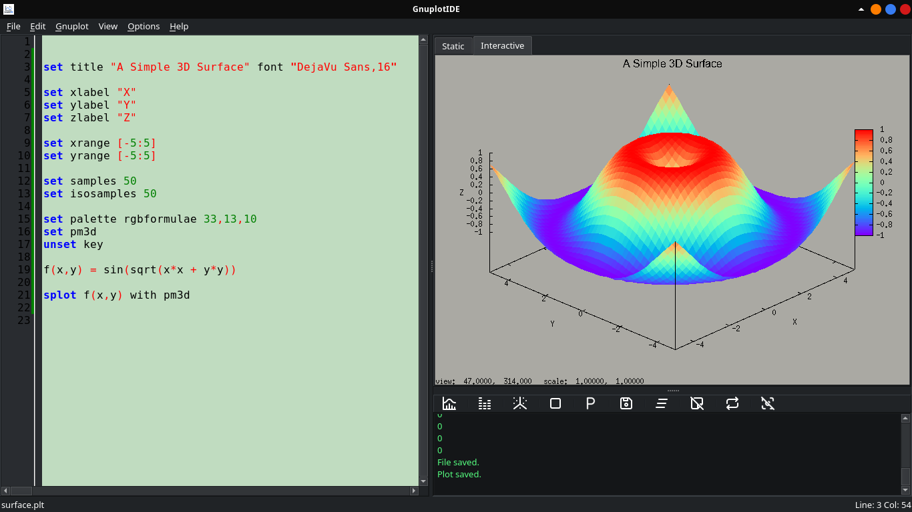
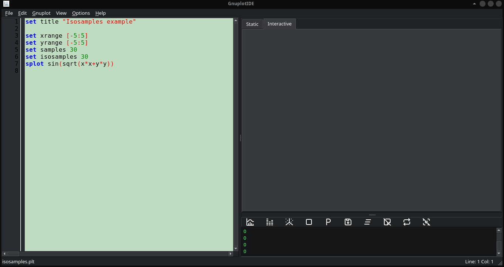
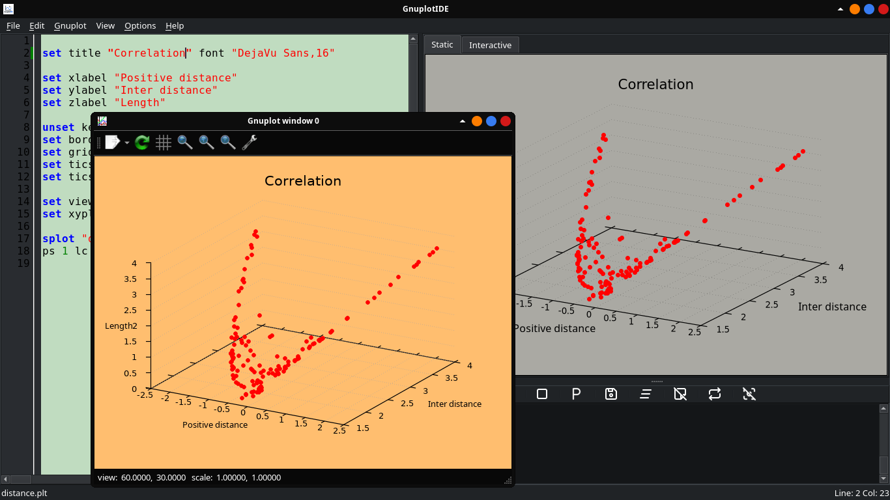
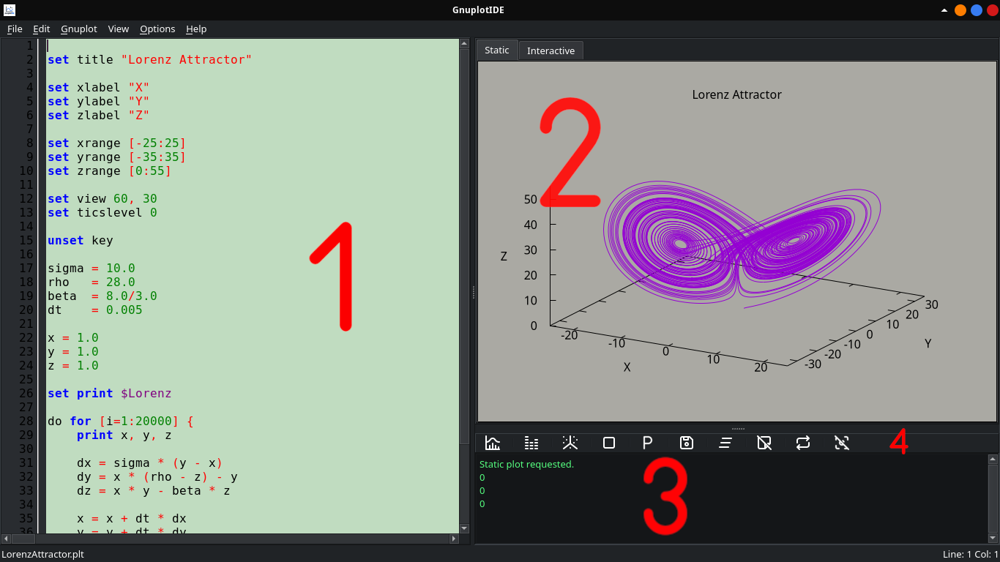

<p align="center">

</p>

## Table of Contents

- [Introduction](#introduction)
- [Motivation](#motivation)
- [Features](#features)
- [Screenshots](#screenshots)
  - [Static Plot Mode](#static-plot-mode)
  - [Interactive Plot Mode](#interactive-plot-mode)
  - [External Plot Mode](#external-plot-mode)
- [Requirements and Dependencies](#requirements-and-dependencies)
  - [Required to Run](#required-to-run)
  - [Required to Build from Source Code](#required-to-build-from-source-code)
- [Installation](#installation)
  - [Precompiled Binary](#precompiled-binary)
  - [Runtime Requirements and Compatibility](#runtime-requirements-and-compatibility)
- [Compiling from Source](#compiling-from-source)
  - [Important: Qt5 Widget Set Required](#important-qt5-widget-set-required)
  - [Compilation](#compilation)
    - [UnTerminal and TermVT](#unterminal-and-termvt)
    - [ExtraSyn](#extrasyn)
    - [RichMemo](#richmemo)
    - [Note](#note)
    - [Optional: Application Icon](#optional-application-icon)
- [File Format and Extensions](#file-format-and-extensions)
  - [Opening Files](#opening-files)
- [Getting Started](#getting-started)
  - [Hello World!](#hello-world)
    - [Static Plot](#static-plot)
    - [Interactive](#interactive-plot)
    - [External Plot](#external-plot)
- [Limitations](#limitations)
  - [Multiple Plots in Static Mode](#multiple-plots-in-static-mode)
  - [Multiplot in Static Mode](#multiplot-in-static-mode)
  - [No Syntax Autocompletion](#no-syntax-autocompletion)
  - [Interactive Plot Limitations](#interactive-plot-limitations)
  - [Application Theming](#application-theming)
  - [Miscellaneous](#miscellaneous)    
- [Interface Overview](#interface-overview)
  - [Editor](#editor)
  - [Preview](#preview)
  - [Message Window](#message-window)
  - [Command Buttons](#command-buttons)
- [Static and Interactive Plot Parameters](#static-and-interactive-plot-parameters)
- [Plot Configurations](#plot-configurations)
- [Logs](#logs)
- [Contributing](#contributing)
- [Acknowledgements](#acknowledgements)
- [License](#license)

## Introduction

GnuplotIDE is a graphical editor and IDE for Gnuplot scripts and data visualization, developed with Lazarus and Free Pascal. The project is intended for researchers, academics, and students who use Gnuplot for data visualization.

## Motivation

This project was initially developed for my own use in computational social science research. The main motivation came from my frustration with the lack of a dedicated Gnuplot IDE and the inconvenience of writing Gnuplot scripts using only the Linux terminal.

Over time, the project expanded into a research-oriented IDE and editor for users who rely on Gnuplot as their primary data visualization tool. The application is lightweight, easy to use, and designed with an intuitive interface that users can understand quickly.

## Features

GnuplotIDE is built with Object Pascal and Lazarus, using native and third-party components to provide an integrated environment for writing and executing Gnuplot scripts.

The application uses the ExtraSyn component to provide Gnuplot syntax highlighting in the editor. It uses UnTerminal to manage Gnuplot processes and handle terminal output, while RichMemo displays output messages in the application's message window.

GnuplotIDE supports three plotting modes:

- **PNG preview:** Displays plots as static PNG images within the application.
- **Embedded X11:** Displays interactive Gnuplot plots inside the application's interface.
- **External Qt window:** Opens Gnuplot's own Qt plotting window outside the main application.

These modes allow users to choose how they view their plots while working with Gnuplot scripts.

The interface uses the Qt widget set through Lazarus and is designed with a spacious, uncluttered layout.

## Screenshots

### Static Plot Mode



### Interactive Plot Mode


### External Plot Mode


## Requirements and Dependencies

#### Required to Run

GnuplotIDE requires Gnuplot to execute scripts and generate plots.

The embedded X11 plotting mode requires a graphical environment with X11 support and a Gnuplot installation that includes the X11 terminal.

#### Required to Build from Source Code

The following tools, components, and modules are required to compile GnuplotIDE:

- Lazarus IDE and Free Pascal Compiler (FPC).
- ExtraSyn — provides the TSynGnuplotSyn syntax highlighter used for Gnuplot scripts.
- RichMemo — provides the rich-text memo component (TRichMemo) used to display output messages in the application's message terminal.
- UnTerminal and TermVT — provide terminal and process-handling functionality used by the application.


## Installation
 
#### Precompiled Binary

A precompiled Linux binary is available on the [Releases page](https://github.com/DiscoCat-Dev/GnuplotIDE/releases). After downloading the binary, you may need to enable the **Allow executing file as program** permission in the file's Properties before running it.

The binary was compiled using Lazarus 4.8 with the Qt 5 widget set on Fedora Linux 43, with Gnuplot 6.0.3 used for testing.

#### Runtime Requirements and Compatibility

The binary depends on system libraries, including Qt 5 and the Lazarus Qt interface library (`libQt5Pas.so.1`). Depending on the Linux distribution and installed packages, required libraries may be missing or incompatible, preventing the application from starting or functioning correctly. Gnuplot must also be installed separately.

The binary has been tested on Fedora Linux 43. Its compatibility with other Linux distributions has not been verified. If the binary does not run on your system, check the required library dependencies and ensure that a compatible version of Gnuplot is installed.

Alternatively, you can compile GnuplotIDE from source using the instructions provided below.

## Compiling from Source

### Important: Qt5 Widget Set Required

GnuplotIDE was developed using Lazarus 4.8 with the Qt5 widget set. Its embedded Gnuplot X11 terminal relies on Qt-specific window identification and embedding. 

Therefore, compiling the application with another widget set, such as GTK2 or GTK3, is not recommended and may result in compilation errors or malfunctioning features.

To compile GnuplotIDE from source, use a Lazarus environment configured for Qt5. If your existing Lazarus installation uses another widget set, configure a suitable Qt5-enabled environment before compiling.

### Compilation 

Compiling GnuplotIDE from source requires following additional components and modules.

#### UnTerminal and TermVT

GnuplotIDE uses UnTerminal and TermVT for terminal and process handling. If these source files are not included in the repository, obtain `UnTerminal.pas` and `TermVT.pas` from their developer's [repository](https://github.com/t-edson/UnTerminal) and make them available to the Lazarus project.   

#### ExtraSyn

ExtraSyn is a third-party Lazarus component package that provides the TSynGnuplotSyn highlighter used by GnuplotIDE.

Install ExtraSyn through Lazarus's Online Package Manager. Rebuild the Lazarus IDE if required by the installation process. After installation, the Gnuplot syntax highlighter will appear under the **SynEdit Highlighters** tab, identified by the **`plt`** glyph. 

See the [ExtraSyn](https://sourceforge.net/projects/lazarus-ccr/files/extrasyn/) project for additional information. 

#### RichMemo

RichMemo is a third-party Lazarus component used to display output messages in GnuplotIDE's message terminal. It is similar to Lazarus's native Memo component but offers additional functionality. It was chosen with future development in mind because of its broader feature set.

Install RichMemo through Lazarus's Online Package Manager. Rebuild the Lazarus IDE if required by the installation process. After installation, RichMemo will appear under the **Common Controls** tab in the component palette. 

For further information, see the [RichMemo](https://wiki.freepascal.org/RichMemo#Introduction) page.

#### <u>NOTE</u>

ExtraSyn and RichMemo are required when compiling the source code that uses them. Users running the precompiled binary do not normally need to install these Lazarus component packages separately. 

#### Optional: Application Icon

GnuplotIDE has its own logo, which can be used as the application's icon on the desktop dock.

Displaying an icon on the desktop dock is different from embedding an icon into the binary executable, as is commonly done with Windows applications. On Linux, application icons are typically associated with desktop entries rather than embedded in the executable in a universally recognized format.

To display the GnuplotIDE icon on the desktop dock, create a desktop entry for the application.

Create a file named `gnuplotide.desktop` in: 

`~/.local/share/applications/` 

Add the following content:

```
[Desktop Entry]
Type=Application
Name=GnuplotIDE
Exec=/path/to/executable
Icon=/absolute/path/to/image.png
StartupWMClass=GnuplotIDE
Terminal=false
Categories=Science;
```

Replace the paths in Exec and Icon with the correct absolute paths on your system. 

For example, the icon path could be:

`/home/name/.local/share/icons/hicolor/128x128/apps/gnuplotide-128.png`

This path points to a 128x128 PNG image stored in the user's local icon directory. 


## File Format and Extensions

Unlike document formats such as Microsoft Word's `.doc` and `.docx`, Gnuplot scripts do not require a single, specific filename extension. They are plain-text files containing Gnuplot commands, and Gnuplot can execute them regardless of their extension.

By convention, GnuplotIDE uses `.plt` as its primary file extension and `.gp` as a secondary extension for Gnuplot scripts.

#### Opening Files 

GnuplotIDE is primarily designed for opening files from within the application after launching it. However, it also supports opening `.plt` and `.gp` files by double-clicking them or selecting them and pressing Enter.

To enable this, create a desktop entry as described in [Optional: Application Icon](#optional-application-icon) under [Installation](#installation), and add `%f` to the executable path in the Exec line. For example:

```
Exec=/path/to/executable %f
``` 
Once configured, double-clicking a `.plt` or `.gp` file, or selecting one and pressing Enter, will open the file in GnuplotIDE. Files with other extensions will not be opened through this method.

If GnuplotIDE is to be used as the default application for opening `.plt` or `.gp` files, change the file association if another application is currently set as the default.

## Getting Started

Using GnuplotIDE is straightforward. GnuplotIDE supports three plotting modes. The preview panel contains two tabs: one for static plots and another for interactive plots.

-   — Displays a static plot in PNG format (F5). 
-   — Displays an interactive X11-based plot that supports mouse and keyboard interaction (F6).
-   — Opens the plot in Gnuplot's native external Qt window (F7).

#### Hello World!

To try the different plotting modes, use the following examples.
##### Static Plot

Enter the following code in the editor, then press the Static Plot button described above.
```Gnuplot
set title "A Simple 3D Surface" font "DejaVu Sans,16"

set xlabel "X"
set ylabel "Y"
set zlabel "Z"

set xrange [-5:5]
set yrange [-5:5]

set samples 50
set isosamples 50

set palette rgbformulae 33,13,10
set pm3d
unset key

f(x,y) = sin(sqrt(x*x + y*y))

splot f(x,y) with pm3d 
```

##### Interactive Plot

To try the Interactive Plot mode, enter the following code in the editor and press the corresponding button.
```Gnuplot
set title "Isosamples example"

set xrange [-5:5]
set yrange [-5:5]
set samples 30
set isosamples 30
splot sin(sqrt(x*x+y*y))
```

##### External Plot

To try the External Plot mode, enter the same code used in the Isosamples example above and press the corresponding button. GnuplotIDE will open Gnuplot's native external Qt plotting window.

These three modes allow users to generate plots quickly and view them in the way that best suits their needs, whether as static images or interactive visualizations.

## Limitations

Although GnuplotIDE is designed to be easy to use, some limitations arise from the way Gnuplot's terminals handle plotting.

1. ### Multiple Plots in Static Mode

Static plotting uses Gnuplot's pngcairo terminal, which generates only one image per plotting session. For example, consider the following commands:

   
   ```Gnuplot
   plot sin(x)
   plot cos(x)
   plot tan(x)
   ```
   
In GnuplotIDE's static preview, only the first plot will be displayed. However, this behavior may appear different when the same commands are executed directly in a system terminal using Gnuplot's interactive prompt (`gnuplot>`). In that case, Gnuplot processes all three commands, generating and replacing the plot each time. Consequently, only the last plot remains visible.

This is not a bug in GnuplotIDE; it results from how the pngcairo terminal handles successive plots within the same session.

In the interactive X11 and external Qt modes, only the last plot is displayed, as expected.

2. ### Multiplot in Static Mode

The multiplot command also behaves differently in the application's static preview. For example, executing the following code in Static Plot mode will leave the other layout areas empty, displaying only the final Parabola plot.

```Gnuplot
set multiplot layout 2,2 title "GnuplotIDE - Multiplot Test"

set title "Sine"
set grid
plot sin(x) with lines lw 2 title "sin(x)"

set title "Cosine"
set grid
plot cos(x) with lines lw 2 title "cos(x)"

set title "Sine + Cosine"
set grid
plot sin(x) with lines lw 2 title "sin(x)", cos(x) with lines lw 2 title "cos(x)"

set title "Parabola"
set grid
plot x**2 with lines lw 2 title "x²"

unset multiplot  
```

The interactive X11 and external Qt modes generate the multiplot correctly.

To work around this issue in static mode, **add `reset` before the set multiplot command**, as shown below:

```Gnuplot
reset #Required for static multiplot  

set multiplot layout 2,2 title "GnuplotIDE - Multiplot Test"

set title "Sine"
set grid
plot sin(x) with lines lw 2 title "sin(x)"

set title "Cosine"
set grid
plot cos(x) with lines lw 2 title "cos(x)"

set title "Sine + Cosine"
set grid
plot sin(x) with lines lw 2 title "sin(x)", cos(x) with lines lw 2 title "cos(x)"

set title "Parabola"
set grid
plot x**2 with lines lw 2 title "x²"

unset multiplot  
```

This produces the correct multiplot layout. However, the reset command may restore the background color to pure white.

3. ### No Syntax Autocompletion

GnuplotIDE does not currently provide syntax autocompletion. Gnuplot's syntax is relatively compact, so automatic completion has not been implemented.

However, GnuplotIDE provides a convenient way to insert data-file names into scripts. Right-click inside the editor to open the context menu, then select Insert Data File. Its submenu lists the data files found in the working directory from which GnuplotIDE was launched.

For a file to appear in this list, it must have the `.dat` extension (for example, `data.dat`). Files with other extensions will not appear in the submenu.

4. ### Interactive Plot Limitations

The interactive X11 terminal does not support antialiasing, so plots may appear less smooth than static PNG previews. Additionally, plots cannot be saved directly from the X11 window.

For higher-quality interactive plots, use External Plot mode, which opens Gnuplot's native Qt window. From there, users can save plots in higher-quality formats.

The Qt terminal cannot be embedded into GnuplotIDE because its plotting area cannot be separated from the window decorations and other interface elements, such as the toolbar and buttons. Therefore, the Qt terminal opens in its own external window.

5. ### Application Theming

GnuplotIDE provides appearance settings for customizing the editor's background color, fonts, and Gnuplot syntax highlighting colors, as well as the Message Window's background color, text color, and fonts. However, it does not provide a dedicated application-wide theming system. The overall appearance of the application depends on the Qt 5 theme configured on the user's system. On Linux, tools such as `qt5ct` can be used to customize the appearance of Qt 5 applications.

**Note on Icon Visibility:** GnuplotIDE was designed specifically for use in a dark-theme environment, which is why it uses white [Tabler Icons](https://github.com/tabler). A dark desktop theme is recommended for better icon visibility. Users who compile GnuplotIDE from source can alternatively replace the original icons with the dark-grey versions provided in `ReadMe-Icons` for use with light desktop themes.

Alternatively, users who compile GnuplotIDE from source can replace the original icons with the dark-grey versions provided in `ReadMe-Icons` folder, which are intended for lighter desktop themes. The distributed binary retains the original white icons.

6. ### Miscellaneous

GnuplotIDE is an independently developed project, created out of a desire to build a practical working environment for Gnuplot. It is not intended to be a perfect, all-encompassing solution or a replacement for other text editors and IDEs.


The application was developed by a single developer, without external funding or institutional support. Like any software project, it may contain bugs, limitations, or unexpected behavior. Any further improvement or development will depend on the time and resources available.
 
## Interface Overview



The GnuplotIDE interface consists of four main components.

1. #### Editor

The editor is the main area for writing Gnuplot scripts. It is designed to be spacious and distraction-free, with a warm background color that is easy on the eyes. Users can customize its appearance via **Options** → **Appearance**.

2. #### Preview

The preview area displays static and interactive plots in separate tabs. In the Interactive tab, users can interact with plots using the mouse and keyboard.

3. #### Message Window

The message window displays output from both GnuplotIDE and Gnuplot itself, including application messages and error messages.

In addition to these messages, numerical values such as 0 and 1 may appear. These are Gnuplot's GPVAL_ERRNO values, which indicate the status of Gnuplot commands. A value of 0 indicates success, while 1 indicates an error. An error status is usually accompanied by an error message.

4. #### Command Buttons

This panel contains the application's main command buttons. In addition to the plotting commands described above (Static Plot, Interactive Plot, and External Plot), it includes the following buttons:

-   — Sends a stop command to Gnuplot (F8).
-   — Displays the names of the last ten plots.
-   — Saves the static plot.
-   — Clears the message window.
-  — Clears the static plot preview.
-   — Displays the most recently generated static plot.
-   — Clears the interactive plot.

The plot-clearing commands can be useful when a plot is rendered incorrectly or becomes unresponsive. However, each plotting command resets the plotting configurations.

## Static and Interactive Plot Parameters

In addition to the main interface components, GnuplotIDE provides two parameter editors: **Static Plot Parameters** and **Interactive Plot Parameters**.

These editors are accessible from the **Gnuplot** menu and are not displayed in the main interface. They allow users to configure plot backgrounds, fonts, and font sizes without cluttering the main editor or repeatedly entering the same commands in their scripts.

The default plot background is warm grey, deliberately chosen to reduce the brightness of Gnuplot's default white background and help alleviate eye strain.

For example, the Static Plot Parameters editor contains the following predefined command:

```Gnuplot
set object 1 rectangle from screen 0,0 to screen 1,1 fillcolor rgb "#aaa9a3" behind
```
Users can change the static plot's background color by modifying this command. They can also add other settings, such as the font and font size used for plot titles.

The Interactive Plot Parameters editor can be used in a similar way. For example:

```Gnuplot
set terminal x11 enhanced background rgb "#081d58"
set title font "DejaVu Sans,16"
```
**Note:** Do not execute plotting commands or commands that set plot dimensions in these parameter editors, as doing so may lead to unexpected behavior.

If you need a publication-quality plot or a plot with custom dimensions, use External Plot mode and save the plot from Gnuplot's native window, or carefully configure the commands in the main editor and specify custom output filenames.

GnuplotIDE is designed to be flexible and generally allows users to execute Gnuplot commands directly. However, plots displayed within the application should be regarded as previews rather than necessarily final output.

Plot parameters, such as plot background colors and fonts, are not saved as permanent application settings. Instead, they belong to the current Gnuplot session and are reset when the session ends. This differs from application settings, such as the editor's font and background color, which are managed separately.

## Plot Configurations

The background colors of static and interactive plots are predefined by the application. However, users can easily change them as described in the [Static and Interactive Plot Parameters](#static-and-interactive-plot-parameters) section.

Each plot generated by the application is assigned a unique name based on the date, time, and milliseconds at which it was created. Generated plots are prefixed with `plot_`, while saved plots are prefixed with `saved_`. All plots are stored in the **GIDEPlots** folder, which is cleared when the application closes. Therefore, users should save any plots they wish to keep.

To locate a plot, users can view the list of plots generated during the current application session using the **Show Plot List** button, then look for the corresponding file in the **GIDEPlots** folder.

Users can also configure plots with custom names or settings by entering the appropriate Gnuplot commands in the editor.

The size of a static plot is determined by the dimensions of its preview window when the plot is generated. Resizing the window afterward does not change the plot's dimensions. This preserves the original image quality, as resizing the image could reduce its visual quality.

Interactive plots and external plots are also affected by the dimensions of their respective display windows. However, unlike static plots, their windows can be resized.

## Logs

GnuplotIDE does not generate general-purpose logs. However, it creates one specific temporary log file named **SizeCheckLog.txt**. This file is generated in the directory from which the application was launched and is deleted when the application closes.

The file records comparisons of the static plot file's size. GnuplotIDE uses these comparisons internally to determine whether plot generation is complete. If a static plot is rendered incorrectly or appears incomplete, this log file can be inspected while the application is running.

The file may contain several lines of size comparisons for each plot. Usually, the last line for a particular plot should show equal sizes, such as **Size1 = 130417 Size2 = 130417**. This indicates that the generation of that plot is considered complete and that the plot should render correctly. If the sizes differ, something may have gone wrong during plot generation.

## Contributing

The current version of GnuplotIDE is designed for Linux. It was developed on Fedora 43 using Lazarus 4.8 with the Qt widget set, and tested with Gnuplot 6.0.3. 

Developers interested in porting GnuplotIDE to Windows or macOS are encouraged to do so. Such independent ports would make the application accessible to users of other operating systems.

## Acknowledgements

GnuplotIDE was developed using the Lazarus IDE and Free Pascal Compiler (FPC), with Free Pascal as its programming language.

Packages such as ExtraSyn and RichMemo have become indispensable parts of the application. I am grateful to their creators and maintainers for their valuable work.

The icons used in GnuplotIDE are from [Tabler Icons](https://github.com/tabler), an open-source icon library. Thanks to the Tabler team and contributors for making these icons available.

Special thanks go to **Tito Hinostroza (t-edson)** and **Ronald Chastain (rchastain)**, contributors to [UnTerminal](https://github.com/t-edson/UnTerminal), for making this library available. GnuplotIDE uses the `UnTerminal.pas` and `TermVT.pas` source files from the project, which is licensed under the GNU Lesser General Public License version 2.1 (LGPL-2.1).

I would also like to thank Tito Hinostroza for his book, [*The SynEdit Bible*](https://github.com/t-edson/La-Biblia-del-Synedit), which provided useful code and guidance during development.

I am grateful to all the creators and contributors whose work helped make GnuplotIDE possible.
- [The SynEdit Bible](https://github.com/t-edson/La-Biblia-del-Synedit) — CC0 1.0 Universal.

## License

GnuplotIDE is licensed under the GNU General Public License v3.0 only (GPL-3.0-only).

See the [LICENSE](LICENSE) file for the full licence text.

Some third-party components included in GnuplotIDE are distributed under their own licences. Please refer to the relevant copyright and licence notices for details.
